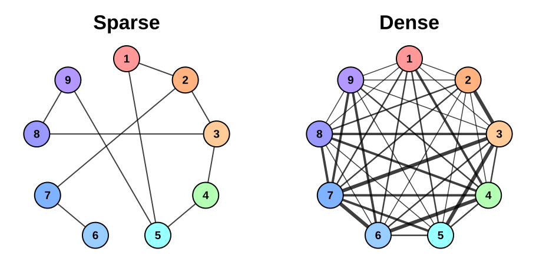
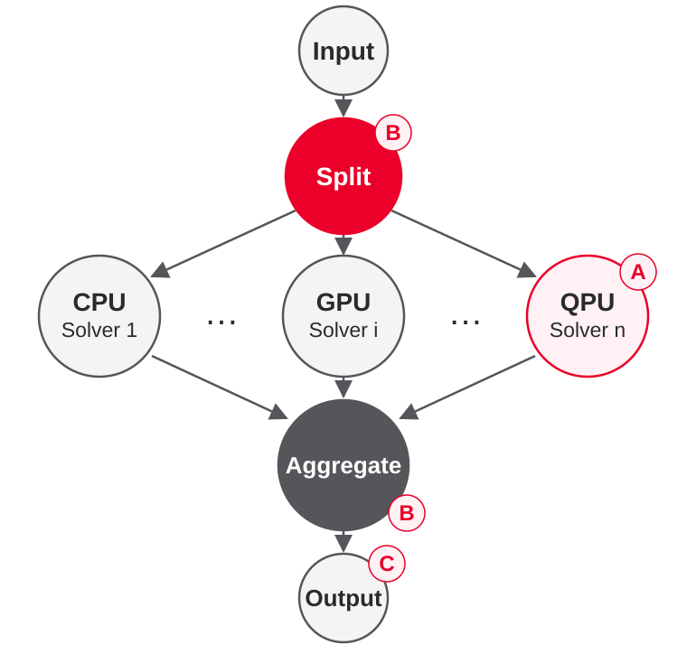
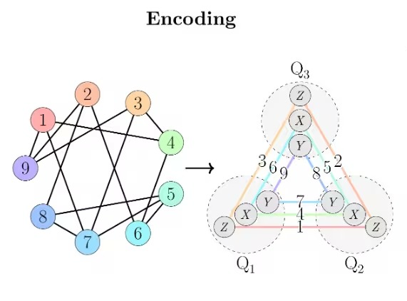
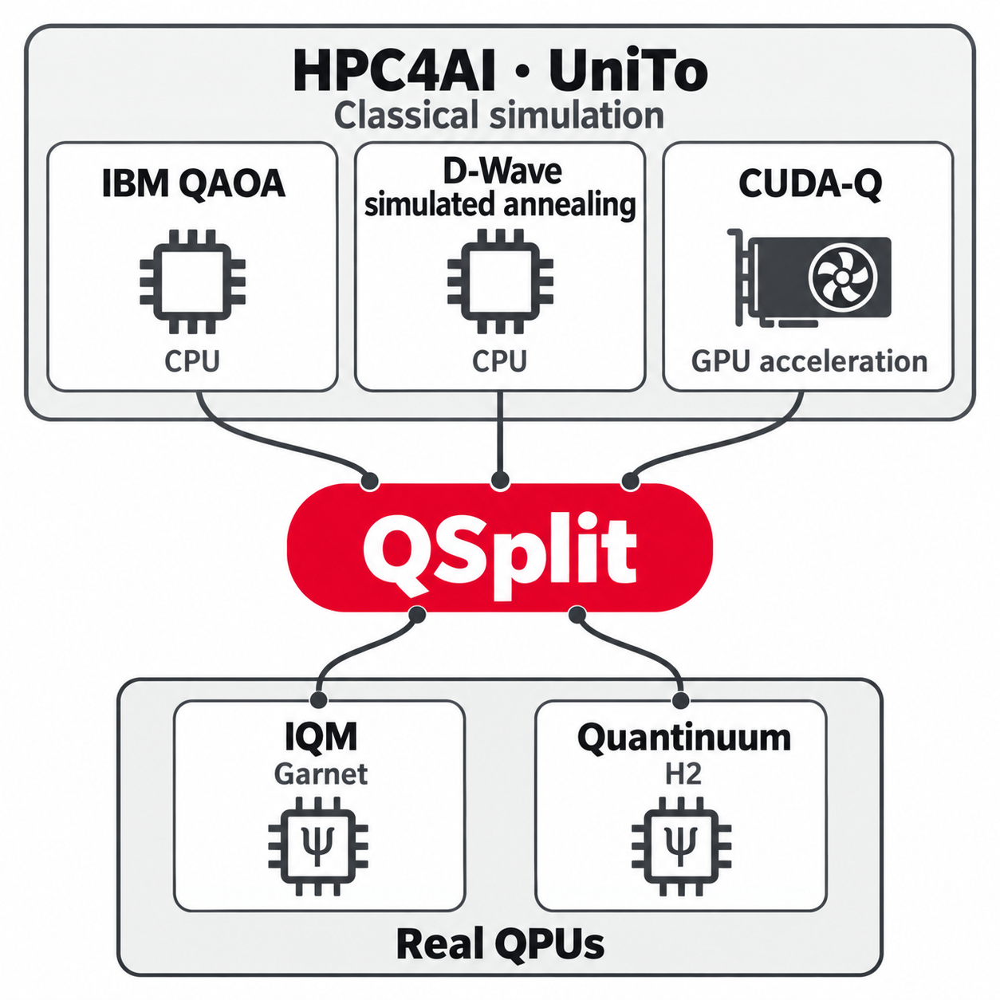
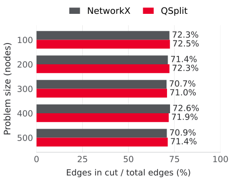

# QSplit: A Workflow-Oriented Hybrid Quantum-Classical Optimization Framework

<strong>Mario Bifulco</strong> - Supervisors: Luca Roversi and Doriana Medić

University of Turin - Department of Computer Science

**Research focus**
How can hybrid quantum-classical workflows tackle optimization problems beyond QPU capacity while balancing solution quality and computational cost? QSplit investigates decomposition, compact encodings, and HPC-QPU integration

## 01 Motivation

### Quantum as an accelerator

Quantum computing is a candidate accelerator within HPC optimization workflows

### Problems outgrow QPUs

Large optimization instances exceed the capacity of current noisy QPUs

### Workflow portability

Different quantum backends require portable orchestration of heterogeneous resources

## 02 Objectives

- **Algorithmic objective**: Preserve solution quality when splitting large QUBOs into QPU-sized tasks
- **Systems objective**: Reduce variational training and data-transfer costs in portable HPC-quantum workflows

## 03 Research questions

- **RQ1 - Decomposition**: How can QUBO structure guide splitting and aggregation to preserve global solution quality?
- **RQ2 - Quantum cost**: Can compact encodings and reduced variational training lower resource use while preserving quality?
- **RQ3 - Integration**: How can heterogeneous solvers be integrated into portable HPC workflows with low overhead?

## 04 Problem & data

**Quadratic Unconstrained Binary Optimization (QUBO)**

$$\min_{x\in\{0,1\}^{n}} x^{\mathsf T}Qx \footnotesize\qquad Q\in\mathbb{R}^{n\times n}$$

QSplit accepts problems formulated as QUBOs. **Max-Cut** is the current test case; generalization depends on **instance structure**, including coefficient sparsity, distribution, and magnitude

## 05 Methodology

### A modular split-solve-aggregate pipeline

QSplit organizes splitting, solving and aggregation into **workflows** that link tasks through data dependencies, enabling reuse of steps and interchangeable solver backends.

For <strong>RQ3</strong>, QSplit uses <strong>StreamFlow</strong> to execute workflows on heterogeneous resources and manage data transfers across hybrid infrastructures.

### A Quantum solvers

To address **RQ2**:

- **Fewer variational cycles**: Study QAOA parameterizations with fewer classical-quantum optimization loops
- **HPC training + QC optimization**: Train QAOA parameters on HPC resources, then use quantum resources for optimization
- **Compact quantum encoding**: Pauli Correlation Encoding (PCE) represents logical QUBO variables through correlations over fewer qubits

### B Structure-aware pipeline

To address **RQ1**, study splitting methods that preserve variable interactions within subproblems and limit information loss during aggregation

### C One-shot approach

A single pass provides a baseline to study solution quality, resource use, and refinement

## 06 Experimental platform

## 07 Current results

50xProblem size vs QPU

- 99%Variational loops

QSplit tackles problems larger than the QPU with reduced variational training and little loss of solution quality

Initial evidence for <strong>RQ1-RQ2</strong> on Max-Cut; generalization to other QUBOs and integration costs (<strong>RQ3</strong>) remain to be evaluated

## 08 PhD roadmap

### RQ1 - Refinement process

Develop optional post-aggregation refinement and assess the quality-resource trade-off

### RQ2-RQ3 - Resource cost

Broaden benchmarks across QUBO structures and backends; measure qubit use, variational loops, runtime, and transfer costs

### Beyond QUBO

Explore constraint-aware mixers (QOLC) and integer formulations (QUIO)

